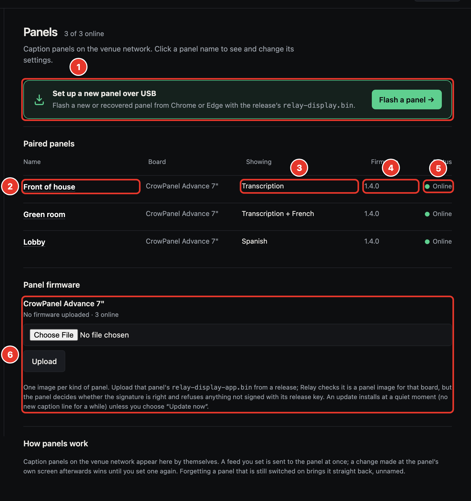
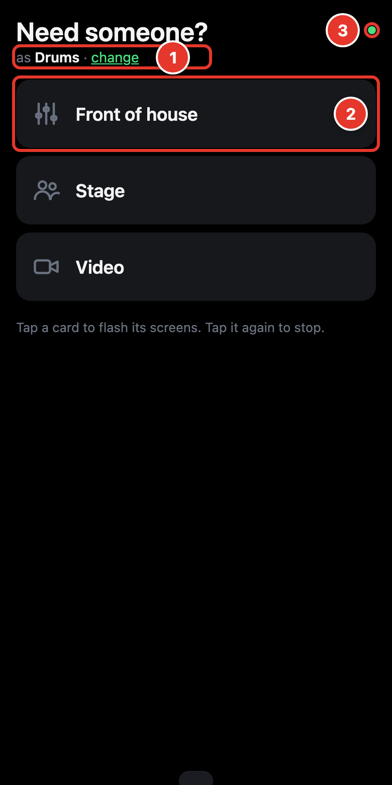

<picture>
  <source media="(prefers-color-scheme: dark)" srcset="brand/export/svg/relay-lockup-on-dark.svg">
  
</picture>

# Relay

Server-captured, low-latency live captioning and translation for remote
viewers. One vendor (OpenAI Realtime), native audio capture, text-only output.

Viewers open a link on their phone and read. Nothing to install, no account,
no microphone permission. The audio is captured on the host machine.

Two front doors, served by Caddy:

| | Serves | On the wire |
|---|---|---|
| **80** | `/` chooser, `/transcription`, `/translation`, `/both`: the link you give the room | plain HTTP |
| **443** | `/admin`: the operator panel | HTTPS |

Those are the ports on the host, so the panel is `https://<host>/admin` with no
port number. Caddy itself listens on 8080 and 8443 inside the container and
Docker publishes them as 80 and 443; set `RELAY_HTTP_PORT` or
`RELAY_HTTPS_PORT` to publish on other host ports (see [Docker](#docker)).

Behind them the relay is one process with two loopback sockets: `port` (8000)
for viewers and `admin_port` (8001) for the panel. Neither is on the network.
`host` is `0.0.0.0` because the room has to reach the viewer link; `admin_host`
is `127.0.0.1` because the panel reads and writes the OpenAI key and the admin
token, and those have no business crossing venue Wi-Fi in cleartext.

Admin routes are refused with a 404 on the viewer port, both in the app and in
Caddy, and the chooser page only offers the panel when it is served on the
admin port, so the audience link never exposes it. Set `admin_port` equal to
`port` in `config.json` to put everything back on one port.

The panel's certificate is self-signed and generated on this machine: there is
no public DNS name on a venue LAN and no ACME challenge to answer, so a real CA
is not an option. Setup prints its SHA-256 fingerprint. Check it against what
the browser shows the first time, then accept the certificate. Without that
check, the warning protects nothing.

**Running Relay at a venue, not developing it?** The
[Relay User Guide](https://github.com/justin-small/Relay/releases/latest/download/Relay-User-Guide.pdf)
([Word version](https://github.com/justin-small/Relay/releases/latest/download/Relay-User-Guide.docx))
walks through installing on macOS, Windows and Linux, getting an OpenAI key
with a spending limit, every screen of the panel, and the Bitfocus Companion
module, in plain English. Its source is in [`docs/guide/`](docs/guide/).

---

## What's new

<p>
  
  
</p>

**Caption panels.** A small touch screen on a wall or desk now shows your
captions without anyone needing a phone. Plug a new panel in, join it to your
Wi-Fi from your phone, and it finds Relay on its own. Show the transcription,
one translation, or two side by side, and turn the picture to any of four
angles to suit how it is mounted. Name each panel, change what it shows, or
restart it from the operator panel, and update its software from there too.

**Set up a panel from your browser.** A new panel is flashed over USB straight
from Chrome or Edge: pick the port, press one button, and watch the progress.
No tools to install.

**Alerts.** When a musician needs the sound desk or the video team, they tap a
button on their phone. The screens you choose flash red and white and show who
is asking, until someone there taps. The first tap stops it everywhere and
tells the sender it was seen. Set up the buttons, icons and screens in the
operator panel; the flashing is once a second.

**Your order of service on the panels.** Connect Planning Center Services and
the panels show what is happening now, what is next and how much time is left.
Where you allow it, a panel's **Next**, **Previous** and **Take control**
buttons move the service on at once. Plan changes reach the panels within
about 30 seconds.

**A tidier operator panel.** A menu down the left groups everything by what
you are doing (Live, Output, Automation, Settings), with a status pill that
always shows whether capture is running.

**Lower cost for many languages.** A new **Text** translation engine
transcribes once and translates each finished line, so adding languages costs
almost nothing. It also adds Arabic, Nepali, Telugu and Hmong.

Every screen is explained, with pictures, in the
[Relay User Guide](https://github.com/justin-small/Relay/releases/latest/download/Relay-User-Guide.pdf).

---

## Install

Requires [Docker Desktop](https://www.docker.com/products/docker-desktop/) (or
Docker Engine on Linux). Nothing else: no Python, no virtualenv, no Caddy.
Everything runs in one container, and setup uses the image's own Python to
write the credentials and mint the certificate.

Get Relay from the [latest release](https://github.com/justin-small/Relay/releases/latest)
(`Relay-vX.Y.Z.zip`, which unzips to a folder named `Relay/`) or clone `main`.

**Setup runs once. Start runs every time.**

| | Set up | Start | Stop | Follow the log |
|---|---|---|---|---|
| **macOS** | double-click `setup.command` | double-click `start.command` | double-click `stop.command` | double-click `logs.command` |
| **Windows 10 / 11** | double-click `setup.bat` | double-click `start.bat` | double-click `stop.bat` | double-click `logs.bat` |
| **Linux** | `./setup.sh` | `./start.sh` | `./stop.sh` | `./logs.sh` |

`setup.*` checks Docker, builds the image, then asks for three things: your
**OpenAI API key**, an **admin token** of your choosing, and optionally a
**hostname** for this machine. The first two are written to
`docker-config/config.json` with permissions `0600`; neither is echoed to the
screen, and neither is ever committed. It then mints the operator panel's TLS
certificate and prints its SHA-256 fingerprint. Write that down.

`start.*` starts the whole stack: Caddy and the relay, one container, one
command. It finds this machine's LAN address first, because the certificate has
to name whatever the operator's browser will dial and that changes with the
venue. If setup has not been run it says so and stops rather than launching a
half-configured relay.

The container runs in the background, so there is no window to keep open.
`start.*` waits until the relay answers, prints both URLs and the panel
certificate's SHA-256, opens the panel in the browser, then closes its window
after 30 seconds (press return to close it sooner). If anything fails, the
window stays open with the error and the last lines of the relay's log. The
relay keeps running until `stop.*`; `logs.*` shows what it is doing, and
closing the log window does not stop it.

Docker restarts the container if it crashes, and again when Docker Desktop
starts, unless `stop.*` ran first. On macOS that restart comes up without the
PulseAudio daemon, which only `start.command` launches, so after a reboot run
`start.command` again rather than relying on the automatic restart.

Run setup again at any time to change the credentials, add a hostname, or renew
the certificate.

<details>
<summary>Manual setup, without the launchers</summary>

```bash
mkdir -p docker-config && chmod 700 docker-config
export RELAY_UID=$(id -u) RELAY_GID=$(id -g)
C="docker compose -f docker/docker-compose.yml"

$C build
OPENAI_KEY='sk-…' ADMIN_TOKEN='your-token' RELAY_ADMIN_FQDN='' \
  $C run --rm --no-deps -e OPENAI_KEY -e ADMIN_TOKEN -e RELAY_ADMIN_FQDN \
  relay python tools/write_config.py
RELAY_ADMIN_IPS=10.0.1.42 $C run --rm --no-deps -e RELAY_ADMIN_IPS \
  relay python tools/setup_caddy.py

RELAY_ADMIN_IPS=10.0.1.42 $C -f docker/docker-compose.linux.yml up
```

The credentials go through the environment rather than the command line so
they never land in a process listing or a shell history file. `RELAY_ADMIN_IPS`
is this machine's LAN address: the container only sees its own bridge address,
so it cannot work that out for itself.
</details>

Audio is the only part that needs per-platform wiring, and the launchers handle
it. See [Docker](#docker) for what each one does and why.

## First run

1. Run `setup.command` / `setup.bat` / `./setup.sh`. Enter your API key and
   admin token, and a hostname if you have one. Leave it blank to certify this
   machine's IP address only.
   Note the SHA-256 fingerprint it prints at the end.
2. Run `start.command` / `start.bat` / `./start.sh`. It prints both URLs: viewers get
   `http://10.0.1.42/`, the panel is at `https://10.0.1.42/admin`. It opens
   the panel for you, and its window closes by itself once the relay is up.
3. Open the panel. The browser warns about the certificate the first time.
   Check the fingerprint it shows against the one from setup, then accept it.
   Sign in with your admin token, and:
   - pick the **capture device** and channel (the meter should move when
     someone speaks into it);
   - toggle on the **target languages** the room needs;
   - press **Start capture**.
4. Session health should show one `connected` session per enabled target.
   Share the LAN viewer link with the room.

> **The admin token is what protects the panel**, and the panel controls a
> session billed to your OpenAI account. Choose a real password, not a word.
> There is no default token: leave it unset and every login is refused. TLS
> keeps the token off the wire, but only if you check the fingerprint. Skip the
> check and you are trusting whatever answered.

## Target languages

The relay runs on `gpt-realtime-translate`, a streaming interpreter model. One
session per target carries **both** feeds, the English transcript and that
target's translation, so there is no separate transcription session to run or
pay for. Billing is per minute of audio, per open session.

Twelve targets are available (the 13 output languages the model supports, minus
the English source): Spanish, Portuguese, French, German, Italian, Russian,
Chinese, Japanese, Korean, Hindi, Indonesian, Vietnamese.

Two things follow from the model:

- **No dialect or register control.** The model takes an output language and
  nothing else: no prompt, no voice, no formality setting. The old
  `es-419 / es-MX / es-CA` selector is gone; a `variant` left in `config.json`
  is ignored. Spanish comes out in a neutral Latin American register.
- **A target must be enabled for anything to appear**, including
  `/transcription`. The English transcript is produced by the translation
  session, so with every target off both feeds are silent. The panel says so.

## Blocked words

Blocked words live in **`docker-config/blocklist.txt`**, one word or phrase per
line:

```
damn
hell
off the record
mierda
hijo de puta
```

On first start the file is copied from `blocklist.txt` in the Relay folder.
**Save it and the change is live within about two seconds, with no restart, so
it is safe to edit mid-event.** The admin panel shows
the same list and can edit it, but the file is the source of truth.

Matches are **removed** from the English transcript and from every
translation. There are no asterisks and no gap on screen.

- Case and accents are ignored: `nino` matches `Niño`, `cabron` matches `cabrón`.
- Whole words only: `ass` will not touch `class`.
- Multi-word phrases work: `off the record` removes all three words.
- Duplicates are collapsed automatically, so repeating a term across sections
  of the file is harmless.
- Lines starting with `#` are comments and are preserved when the panel saves.
- Comma-separated input works too, if you'd rather paste a list in one line.

**Each feed is filtered independently.** A word blocked in English does not
block its translation, because the translation is produced from audio, not from
the English text. To remove a term everywhere, list it in each language.

Because captions stream in fragments, a banned word can arrive split across
deltas (`"dam"` then `"n"`). The filter holds back any trailing text that could
still grow into a blocked term, so a partial word never renders and then
vanishes. The hold is narrow: measured against a 464-term list, roughly 0.2%
of words are briefly held, so latency is unaffected.

One caveat: the filter removes words, it does not rewrite grammar. Removing a
noun mid-sentence leaves a gap ("the first item on is the review"). For a word
you expect often, blocking the phrase around it usually reads better.

## Recording and export

**Off by default.** Turn it on in the panel under *Recordings & export*, or set
`recording.enabled` in `config.json`. Nothing is written to disk until you do.

A recording covers **exactly one run, from *Start capture* to *Stop***. Each
committed caption line is appended as it happens, so a crash or a power cut
mid-event still leaves you everything said up to that point. Blocked words are
removed before anything is written, so a term on the blocklist never reaches
the file.

Runs land in `recordings/` (`docker-config/recordings/` under Docker), one
directory per run:

```
recordings/20260920-143012/
  meta.json     start and stop time, source language, line count
  lines.jsonl   every committed line, as it happened
```

The panel lists past runs with their duration and line count. **Download the
whole run as a zip, or any single file.** Everything but `lines.jsonl` is
derived at download time, so nothing is duplicated on disk and a future
improvement to the pairing applies to old events too.

| File | What it is |
| --- | --- |
| `transcript-<LANGUAGE>.txt` | One timestamped line per caption, per language. What a client asks for after an event. |
| `pairs-<TARGET>.jsonl` | Each source line matched to its translation, with a `confidence` field. The audit copy. |
| `finetune-<TARGET>.jsonl` | The confident pairs only, in OpenAI chat format, ready to upload to a fine-tuning job as-is. |

One file set per target language, so a run with Spanish and French produces a
clean English→Spanish pair set and a clean English→French one, rather than one
file you have to reshape.

### How source and translation are matched

There is **no segment id tying a source line to its translation.** The two
feeds arrive as separate event streams and are broken into lines independently
by this app's own idle timers, so the counts do not match: one spoken sentence
can commit as one English line and two Spanish ones, or the reverse.

What the feeds do share is the clock. Lines are matched on **overlapping time
span**, and every row in the pairs file says how sure that match is:

| `confidence` | Meaning |
| --- | --- |
| `exact` | One source line, one translation, neither claimed twice. |
| `merged` | Several source lines inside one translation's span, joined. |
| `split` | One source line answered by several translations. |
| `loose` | No overlap and no unambiguous near match; the nearest line within a wider window. |
| `unpaired` | Nothing plausible on the other side, usually a dropout. |

**Only `exact` rows are carried into the fine-tuning file.** The rest stay in
the pairs file, where they can be reviewed, corrected or ignored. The model is
interpreting, so a translation routinely lands just *after* the sentence it
answers with no overlap at all. That case is matched to the source line that
had just finished, which also stops the *next* sentence being swept in when a
speaker pauses briefly.

### Retention

`recording.keep_runs` (default 20) caps how many runs are kept. The oldest are
pruned when a new run starts, so a machine left running a season of events
cannot fill its disk. Individual runs can be deleted from the panel; the run
currently being recorded cannot.

Recordings are a transcript of everything said in the room. `recordings/` is
git-ignored, and under Docker the directory sits on the state volume so it
survives the container and can be collected from the host.

## Schedules

Capture can start and stop on its own. Under *Schedules* in the panel, add as
many as you need. Each one has a start time, a stop time and a US time zone, and
either repeats weekly on the days you tick or runs once on a date:

| Schedule | Repeats | Start | Stop |
| --- | --- | --- | --- |
| Sunday morning | Every Sun | 10:00 AM | 12:00 PM |
| Sunday evening | Every Sun | 5:00 PM | 7:00 PM |
| Wednesday night | Every Wed | 8:00 PM | 9:30 PM |
| Christmas Eve | Once, 12/24/2026 | 7:00 PM | 8:30 PM |

A weekly schedule can have optional start and end dates. A stop time earlier
than the start time means the next day, so 11:00 PM to 1:00 AM works. The panel
shows the next scheduled start, and the bottom bar says which schedule started
a live session and when it will stop.

**Formats and zones.** Dates are shown and entered as MM/DD/YYYY and times as
12-hour with AM/PM, whatever the browser's locale. The zones offered are
Eastern, Central, Mountain, Arizona (no daylight saving), Pacific, Alaska and
Hawaii. Times are wall-clock in the zone you pick, so 10:00 AM stays 10:00 AM
on both sides of a daylight-saving change. A time that falls in the
spring-forward gap runs at the first minute after it; one in the repeated
fall-back hour runs once.

**Rules.**

- **Already running when a window opens:** it keeps running and stops at the
  window's end.
- **You press Stop during a window:** the window is held, and nothing restarts
  until the next scheduled start. Pressing Start clears the hold, and that
  session stops at the window's end.
- **You start by hand outside any window:** no schedule stops it.
- **Windows that overlap or touch** run as one session, with no stop and
  restart at the boundary.
- **Changing or deleting a schedule while its session is live** never cuts the
  session off. Stop it by hand.
- **A start that fails** (no API key, audio device missing) shows the error in
  the panel and is retried every few seconds while the window is open.

**The machine and the relay must be running** for a schedule to fire. If the
relay starts during a window, the session starts straight away. A window missed
entirely is skipped, not run late. A hold is kept in memory only, so a restart
during a held window starts the session again.

Schedules are stored in `config.json` under `schedules`, with ISO dates
(`YYYY-MM-DD`), 24-hour times (`HH:MM`) and days counted from Sunday = 0. See
`app/schedules.py` for the shape. An entry edited by hand that does not
validate is ignored rather than stopping the relay.

## Docker

Relay runs only in Docker, as a single container. The build is reproducible,
the dependencies are pinned, and the host needs nothing but Docker.

Audio is the only part that needs per-platform wiring, and the launchers handle
it:

| Host | Start it with | Audio |
|---|---|---|
| **macOS** | `./start.command` | starts a PulseAudio daemon on the Mac and bridges it in |
| **Windows 10 / 11** | `start.bat` | starts a PulseAudio daemon on Windows, on loopback only, and bridges it in |
| **Linux** | `./start.sh` | `/dev/snd` passed straight in |

Each launcher runs `tools/check-audio.sh` (`tools/check-audio.ps1` on Windows,
where there is no bash) first and refuses to go live quietly
if a link in the chain is broken, then finds this machine's LAN address and
hands it to the container. State lives in `./docker-config/`: the API key,
admin token, blocklist, the generated `Caddyfile` and the panel's certificate,
all surviving rebuilds.

Caddy runs **inside the same container** as the relay, so there is nothing
else to launch or keep running. The entrypoint mints the
certificate if setup has not already, validates the generated Caddyfile, then
supervises both processes; if either exits, the container exits and
`restart: unless-stopped` brings back a known-good pair rather than leaving a
half-running container that still passes a shallow probe.

| | Outside | Caddy, in the namespace | Relay |
|---|---|---|---|
| **Viewers** | `:80`, plain HTTP | `:8080` | `127.0.0.1:8000` |
| **Panel** | `:443`, HTTPS | `:8443` | `127.0.0.1:8001` |

Caddy binds unprivileged ports inside and the host publishes 80 and 443 in
front of them. That is deliberate: binding a privileged port directly would
need `CAP_NET_BIND_SERVICE`, and the container keeps `cap_drop: ALL`.

### What the container is allowed to do

The image runs unprivileged with a read-only root filesystem and no Linux
capabilities at all. In practice that means:

| | |
|---|---|
| **User** | `10001:10001`, never root. On Linux, pass `RELAY_UID`/`RELAY_GID` so the bind-mounted `docker-config/` matches your account; Docker Desktop fakes ownership, so macOS and Windows can ignore this. |
| **Filesystem** | `read_only: true`. `/app` cannot be rewritten by the process that runs it. Writable: `docker-config/` (state), plus small tmpfs mounts for `/tmp` and `$HOME`. |
| **Privileges** | `cap_drop: ALL` and `no-new-privileges:true`, so there is no setuid escalation path. |
| **Limits** | 1 GB memory, 2 CPUs, 256 pids, and log rotation at 3 × 10 MB, so a wedged run cannot fill the host. |
| **Base images** | `python:3.12-slim-bookworm` and `caddy:2-alpine`, both pinned by digest; dependencies installed wheels-only in a builder stage, so no compiler or pip ships in the runtime image. Only Caddy's binary is taken from its image, copied with `cp` so its `cap_net_bind_service` file capability is dropped: `execve` of a file with capabilities fails outright under `no-new-privileges`. |
| **Front end** | Caddy, in the same container with the same lifecycle. `admin off`, because its control socket is unauthenticated and can rewrite the whole config, and nothing here needs it. `auto_https off`, because nothing is public: it never tries ACME and never redirects viewers to a certificate they cannot trust. |
| **Panel key** | Minted in the container by setup, into `docker-config/certs/` at mode 0600. It is never in an image layer and never in a registry. Reused across restarts while it still covers the current names, so the fingerprint you wrote down at setup is the fingerprint you see at showtime. |

**The relay's own sockets never leave loopback.** `:8000` and `:8001` are
cleartext and live inside the network namespace; they are not published at all.
Everything from outside arrives through Caddy, which means the panel is only
ever reachable over TLS. The certificate names the host's LAN address, which
the container cannot discover for itself. The launchers pass it in as
`RELAY_ADMIN_IPS` on every start, and `admin_fqdn` in `config.json` (asked for
at setup) adds a hostname.

If you would rather not expose the panel to the LAN at all, publish it on the
host's loopback only and tunnel to it. Change the panel's line in
`docker/docker-compose.yml` to `"127.0.0.1:${RELAY_HTTPS_PORT:-443}:8443"`,
then:

```bash
ssh -N -L 8443:127.0.0.1:443 you@relay-host   # then open https://localhost:8443/admin
```

The Companion module then has no way in; it needs the panel port on the LAN.

**Why the wiring is needed:** the relay captures from a host sound card
through PortAudio, and a container only sees devices the host hands it.

### Scanning the image

The base images are pinned by digest, which is right for reproducibility and
wrong for CVEs: the layer is frozen, so an advisory published against Debian
bookworm, CPython or Caddy lands silently and the build keeps succeeding.
Two things make the pin safe. Dependabot proposes the digest bump weekly
(`.github/dependabot.yml`), and scanning proves the new layer is actually
cleaner than the old one before it merges. `tools/scan-image.sh` runs the scan
locally, with no CI, no account and nothing to install beyond Docker:

```bash
./tools/scan-image.sh                 # build, then scan
./tools/scan-image.sh --no-build      # scan the image already built
./tools/scan-image.sh --severity CRITICAL
./tools/scan-image.sh --all           # include won't-fix advisories (noisy)
./tools/scan-image.sh --json reports/ # also save the raw JSON
```

Three passes: image vulnerabilities (Debian packages *and* the Python venv
*and* the Caddy binary's Go modules), Dockerfile/compose misconfiguration, and
secrets in the working tree. Only the first can fail the run: the exit status
is the number of **fixable** HIGH/CRITICAL findings, so a clean run means every finding has
a version to move to. The other two print and never fail the run.

Trivy does the work, from its own pinned container by default; a `trivy` on
your PATH is used instead when you have one. The vulnerability database is
cached in a named volume, so only the first run downloads it. Run the scan
before an event and after any dependency bump. Also run it when nobody has
touched the repo for a while, because that is when a frozen base image is most
likely to be stale.

Findings come in two kinds, and the fix differs:

| Where | Fix |
|---|---|
| OS package or Caddy's Go modules | Bump the pinned digest in `docker/Dockerfile`, usually by merging Dependabot's PR, or by hand with `docker pull python:3.12-slim-bookworm` (or `caddy:2-alpine`) then `docker image inspect ... --format '{{index .RepoDigests 0}}'`. For Caddy this currently changes nothing; see *Known findings* below. |
| Python package | Bump it in `requirements.txt` and rebuild. |

Pass 3 flags your own `config.json` if it holds a real key. That is the
scanner working, not a leak: the file is git-ignored and never enters an image
layer. It is worth reading anyway, because it is the same check that would
catch a key pasted into a file that *is* tracked.

### Known findings: the Caddy binary's Go modules

As of 2026-09-21 a clean scan is not achievable. The reason is recorded here so
nobody has to investigate it again. `caddy:2-alpine` ships
Caddy 2.11.4 built against Go 1.26.3, and Trivy reports **17 fixable HIGH**
findings inside that one binary:

| Module | In image | Fixed in | Count |
|---|---|---|---|
| Go `stdlib` | 1.26.3 | 1.26.6 | 11 |
| `google.golang.org/grpc` | 1.81.0 | 1.83.2 | 3 |
| `golang.org/x/crypto` | 0.52.0 | 0.55.0 | 1 |
| `golang.org/x/net` | 0.55.0 | 0.56.0 | 1 |
| `golang.org/x/text` | 0.37.0 | 0.39.0 | 1 |

Re-pinning the digest does **not** clear them. Upstream's current
`caddy:2-alpine` carries the same binary built against the same toolchain.
Scanning it directly gives the same 17 findings, with a clean Alpine layer.
Upstream has not rebuilt yet; this repo is not behind.

What actually affects this deployment:

- **Not reachable.** `x/crypto/ssh` (Caddy runs no SSH), the three gRPC
  findings (no gRPC listener; `admin off`), `dnsmessage` (no ACME DNS
  challenge; `auto_https off`), and the `os.Root` symlink traversal (no
  file-serving path takes an attacker-controlled root).
- **Reachable, LAN-scoped.** The `crypto/tls` KeyUpdate and HTTP/2 denial of
  service on the panel's HTTPS listener (8443 in the container, 443 on the
  host), plus `net/url` and MIME header parsing on any request Caddy accepts.
  All are denial of service, need a device already on the venue LAN, and fail
  as "captions stop", which the operator sees immediately.
- **`html/template` XSS** needs Caddy to render a template with attacker
  input. This deployment serves static viewer assets and proxies; it renders
  none.

None of it is remote code execution, and none of it is reachable from the
public internet, because nothing here is on the public internet.

The plan is to wait for upstream, then re-pin the `caddy:2-alpine` digest in
`docker/Dockerfile` once it ships a Go 1.26.6 build. `./tools/scan-image.sh`
re-checks on every run, so the scan shows when that happens. Nothing is
suppressed. There is deliberately no `.trivyignore`, because it would also hide
the next real Caddy finding, and the exit status stays at 17. If upstream is
still on 1.26.3 long after this was written, the alternative is to build Caddy
in a builder stage from a current `golang:` image. That gives a toolchain we
control, but it has to be maintained.

### Windows: PulseAudio

One path for Windows 10 and 11 alike. Docker Desktop runs on WSL2, its default
backend, but nothing here uses a Linux distro of your own: `setup.bat` and
`start.bat` run `docker compose` straight from Windows, and the microphone
comes in the way it does on macOS: from a PulseAudio daemon running natively
on the host. Operators double-click the `.bat`; nobody opens a Linux shell.

`setup.bat` downloads a PulseAudio build for Windows
([pgaskin/pulseaudio-win32](https://github.com/pgaskin/pulseaudio-win32) v5,
PulseAudio 15) into `.pulseaudio\`, which is git-ignored and never in the
image. It refuses the download unless its SHA-256 matches the one pinned in
`tools/windows-audio.ps1`. `start.bat` then starts the daemon hidden, so
closing the window leaves it running, and `stop.bat` stops it. By hand:

```bat
powershell -ExecutionPolicy Bypass -File tools\windows-audio.ps1 start
docker compose -f docker/docker-compose.yml -f docker/docker-compose.windows.yml up -d
```

The daemon loads one capture source per Windows recording device, named after
the device, so the panel lists them by name ("WaveIn on USB Audio CODEC").
Windows trims those names to 31 characters. A device plugged in after
`start.bat` needs `stop.bat` and then `start.bat` to show up. Unlike on macOS,
**Rescan** alone does not find it.

It listens on **127.0.0.1 only**. Docker Desktop forwards the container's
`host.docker.internal` to the host's loopback, so the container reaches the
daemon while nothing on the LAN can. That matters because the Pulse protocol
here is unauthenticated (`auth-anonymous=1`). It also means Windows Firewall
never prompts for it.

Windows gates desktop apps' microphone access: **Settings → Privacy →
Microphone → "Allow desktop apps to access your microphone"** must be on, or
the sources appear and read pure silence. `check-audio.ps1` fails on exactly
that.

### macOS: PulseAudio

`./start.command` does this for you. To run it by hand:

```bash
brew install pulseaudio
pulseaudio --exit-idle-time=-1 --log-target=stderr \
  --load="module-native-protocol-tcp port=4713 auth-anonymous=1 auth-ip-acl=127.0.0.1;192.168.65.0/24;172.16.0.0/12" &
docker compose -f docker/docker-compose.yml -f docker/docker-compose.macos.yml up
```

The ACL must cover Docker Desktop's VM subnet (`192.168.65.0/24`) and the
bridge range (`172.16.0.0/12`). The container is not on your LAN, so
`127.0.0.1` alone refuses it. `--daemonize=yes` fails on the Homebrew build;
background it instead.

macOS gates capture per process: the terminal running PulseAudio needs
Microphone permission (System Settings → Privacy & Security → Microphone), or
sources appear and read pure silence.

With `PULSE_SERVER` set, the panel's device list shows the PulseAudio server's
inputs by name ("PulseAudio: MacBook Pro Microphone") rather than ALSA's
`default` and `pulse`, which both only reach the server's default input.
Picking one opens that source directly. A mic connected later (an iPhone, a
USB interface) shows up after **Rescan**, even while capture is running.

### Verifying the chain

`tools/check-audio.sh` walks the whole path and prints PASS/FAIL per link, so a
broken mic turns up at setup rather than at showtime. Exit status is the
number of failures.

```bash
./tools/check-audio.sh                                              # Linux
PULSE_SERVER=tcp:host.docker.internal:4713 ./tools/check-audio.sh   # macOS
powershell -ExecutionPolicy Bypass -File tools\check-audio.ps1        # Windows
```

It checks that the image exists, the server answers, sources are listed,
PortAudio enumerates an input, and one second of audio actually arrives. It
also fails separately on *digital silence*. That is what a missing microphone
permission looks like on macOS and Windows, and otherwise it looks exactly like
a working setup.

### Rehearsal in Docker

```bash
RELAY_DEMO=1 RELAY_ADMIN_IPS=127.0.0.1 \
  docker compose -f docker/docker-compose.yml up
```

No audio wiring needed, no API calls, no billed session.

### Sample rate

PortAudio reports 44100 for ALSA's `pulse` device whatever the server actually
runs at, so a 48k source would be resampled to 44.1k by PulseAudio and then to
24k by soxr. That is two conversions and a slower start (about 4.8 s to steady
state, against about 1.6 s). The entrypoint therefore sets `RELAY_NATIVE_RATE=48000`, which
`app/audio.py` uses in place of the reported default. Set it to your device's
rate if that is not 48k, or to `0` to take PortAudio's default. Linux hands
`/dev/snd` straight in, so `PULSE_SERVER` is unset there and none of this
applies.

### Caveats

Published ports, not host networking, so the console prints the container's
address rather than the LAN one. Give the room the host machine's own LAN
address on `:80`. The same blind spot is why the certificate needs
`RELAY_ADMIN_IPS`: the container cannot name an address it cannot see.

The macOS and Windows paths add a network hop to a pipeline tuned for latency,
and a PulseAudio daemon that can fail on event day. Check the audio before the
room fills up. On Windows the hop never leaves the machine. Linux (`/dev/snd`
straight in) has neither problem.

`auth-anonymous=1` means anything that can reach the PulseAudio port can
listen to that microphone. Keep `auth-ip-acl` narrow and do not forward the
port beyond the host.

## Rehearsal mode

Check fonts, projector legibility and the link on every phone in the room
**without opening a billed session**:

```bash
RELAY_DEMO=1 ./start.sh            # or start.command / start.bat
```

`RELAY_DEMO` is read from the environment and passed through to the container.

Canned captions stream to the viewer pages. No OpenAI connection is opened.

## Cost

Cost is `(enabled targets) × (time)`, billed per minute of audio, including
silence, because the sessions stay open by design. One session per target carries both
the English transcript and that target's translation, so running Spanish is one
stream, not two. Viewers cost nothing.

In **Text** translation mode there is one transcription session and a text
model translates each finished line, so extra languages cost almost nothing;
captions then arrive a line at a time.

**Press Stop between sessions.** Nothing else controls the cost.

## Tuning line breaks

**Phrase boundaries are not tunable.** `gpt-realtime-translate` decides where a
phrase ends from the audio itself, and the translations endpoint has no turn
detection to configure: there is no `semantic_vad`, no `eagerness`, no
millisecond threshold. A translation session has no turn lifecycle at all;
sending `turn_detection` is rejected outright. If you have an older
`config.json` carrying `vad_mode`, `vad_eagerness` or the `vad_*_ms` fields,
they do nothing and are dropped the next time the file is saved.

What you *can* steer is when this app commits a caption **line**: the point at
which streaming text stops changing and settles. Both controls are in the panel
under *Appearance & tuning*:

- **Caption line break after silence** (`realtime.segment_idle_s`, default
  1 s). A line is committed once its text has been quiet this long **and** it
  ends on a sentence boundary. Lower it for snappier lines.
- **Force a line break after** (`realtime.segment_max_idle_s`, default 10 s).
  The backstop for a line that never reaches a sentence end, always applied at a
  word boundary so a word is never cut in half. Raise it if you see one sentence
  split across two lines.

In-progress text is already on screen as it streams, so a generous backstop
costs nothing: it changes when a line *settles*, not when it appears. Changing
either restarts live sessions.

If captions arrive late rather than in awkward chunks, the cause is upstream.
Check the host's bandwidth and the session health table, not these two fields.

## Audio decisions

- **24 kHz / 16-bit / mono.** The format the Realtime API ingests. Captured at
  the interface's native rate, downsampled with soxr.
- **No silence trimming.** Audio streams continuously, silence included.
  Gating risks clipping word onsets and breaking the model's context, and saves
  nothing meaningful. A local RMS check drives the admin "speaking" indicator
  only; it never sits on the path to the API.
- **The input meter reads dBFS.** −60 dBFS at the left edge, 0 at the right,
  with the −18 dBFS target band marked: aim the loudest speech at that band.
  The bar is RMS, the thin marker is a peak hold that decays at 20 dB/s, and
  the **CLIP** indicator latches red for three seconds whenever a sample hits
  the rail. Clipping is the most common cause of bad transcription from a
  console feed, and short transients are invisible on an RMS bar alone. Watch
  the LED, not the bar. The cumulative clipped-sample count sits beside it and
  resets on each Start.
- **Stereo feeds can be summed.** The channel selector offers **Mix** on any
  interface with more than one input channel, which averages them rather than
  discarding one. That is usually the right choice for a stereo board feed. Averaging,
  not adding, so the downmix cannot clip where the source channels did not.
- **Noise reduction defaults off.** The `Noise reduction` control in the admin
  panel's Audio input section sends nothing for a house console feed, which is
  already gated and gain-staged. Reduction runs before the model's own phrase
  detection, so on a conditioned board mix it can clip the start of words.
  Switch to *Room or laptop mic* (`far_field`) or *Headset / lavalier*
  (`near_field`) only when the capture really is one of those.

## Security

- The OpenAI key lives only in `config.json` on the host (mode `0600`,
  git-ignored) and is never sent to a browser. The admin panel shows only
  whether a key is set and its last four characters.
- Viewer pages are read-only and unauthenticated, and served in plain HTTP,
  which suits a venue LAN. They carry no secret, and a room full of phones
  will not install a certificate to read captions.
  **Do not expose this server to the public internet as-is**: viewer pages have
  no access control and no transport security.
- The operator panel is a different matter, and is served over HTTPS by Caddy
  (`docker-config/Caddyfile`, generated at setup). The relay's
  own admin socket binds `127.0.0.1` (`admin_host` in `config.json`), so the
  only route in is through TLS. The certificate is self-signed and generated on
  the host. Setup prints its SHA-256 fingerprint; check it once against the
  browser, or the TLS proves nothing.
- Behind the front end the app reads `X-Forwarded-For` and `X-Forwarded-Proto`,
  but **only from a loopback peer**. A direct client on the LAN cannot forge
  either: not its address, to dodge the login lockout, and not the scheme, to
  influence the cookie.
- The admin token is set by `setup.*` and stored in the same file. **There is
  no default token.** An unset token does not leave the panel open, because
  every login is refused, but it does mean nobody can operate the
  relay until setup has run.
- Signing in issues a random session id; the admin token itself never goes
  into a cookie. Sessions are held in memory, so they last 12 hours, die on
  restart, and are all revoked when the token is changed. The cookie is
  `HttpOnly` and `SameSite=Strict`. It is also `Secure` whenever the login
  arrived over TLS, but not on a plain-HTTP login, where the browser would drop
  a `Secure` cookie and lock the operator out.
- Failed logins are delayed and logged, and an IP is locked out for five
  minutes after five failures in a row.
- The Planning Center token is stored only in `config.json` and is never
  sent to a browser, a panel or a log. Panels on the viewer port can read the
  Service feed with no login, and a panel the operator allows to control sends
  a key over plain HTTP: see *Planning Center Services LIVE*.
- Translation sessions are instructed to treat everything they hear as content
  to translate, never as instructions to follow.
- The container image is scanned locally with `tools/scan-image.sh` (see
  Docker → *Scanning the image*). Pinned base layers go stale, and the scan
  shows when they have.
- **If you ever paste an API key somewhere it should not be, revoke it** at
  <https://platform.openai.com/api-keys> rather than deleting the file. A key
  that has been written to disk, a log or a screenshot should be considered
  spent.

## Troubleshooting

| Symptom | Cause / fix |
|---|---|
| `Incorrect API key provided` | The key is wrong. Sessions stop rather than retry. Paste the right key and press Start again. |
| Sessions say `reconnecting` and climb | Network. Reconnect is automatic with backoff; check the host's connection. |
| Meter is flat while someone speaks | Wrong device or wrong channel. Try each channel, or **Mix** on a stereo feed; press Rescan if the interface was plugged in after launch. |
| CLIP indicator keeps lighting | The feed is too hot. Reduce gain at the console or interface until the peak marker sits at the −18 dBFS band and CLIP stays dark. Clipped audio transcribes badly and no model setting recovers it. |
| Meter moves but sits far left | Input gain is too low. Below about −40 dBFS the model has little to work with; bring the loudest speech up to the marked band. |
| `No input device matched` | The interface was unplugged. Reselect it and press Start. |
| Viewers see "No target language is live" | Every target is toggled off, or capture is stopped. |
| A blocked word still appears in a translation | Each feed is filtered independently. Add that language's form to the list as well. |
| Edited `blocklist.txt` but nothing changed | Give it about 2 s. Check the relay's log (`logs.*`) for the line `Blocked words reloaded: N term(s)`, and that the file is the one named in the admin panel. |
| A blocked word appears inside a longer word | By design: only whole words match. Add the longer word explicitly. |
| Captions lag or arrive in long blocks | Phrase boundaries come from the model and are not tunable. Long *lines* are a line-break setting: lower *Caption line break after silence*. Real lag is upstream: check the host's bandwidth. |

## Layout

```
setup.command / .bat / .sh   one-time setup: image, credentials, panel TLS
start.command / .bat / .sh   start the whole stack (Caddy + relay, one
                             container) in the background. One per platform:
                             macOS, Windows, Linux.
stop.command / .bat / .sh    stop it (and, on macOS / Windows, its PulseAudio daemon)
logs.command / .bat / .sh    follow the running relay's log
run.py                       in-container entry point; binds both sockets
requirements.txt             pinned dependencies (installed into the image)
config.example.json          template, used when tests run outside the image
blocklist.txt                default blocked words, copied into docker-config/
                             on first start

docker-config/               all state, git-ignored, created by setup
  config.json                live config (0600): API key, admin token, admin_fqdn
  blocklist.txt              the live list: hot-reloaded, written by the panel
  Caddyfile                  generated from config.json on every start
  certs/admin.{crt,key}      operator panel certificate (key 0600)
  recordings/                recorded runs, if recording is enabled

app/
  main.py                    FastAPI routes, SSE, admin API
  engine.py                  capture -> sessions -> hub wiring, target toggles
  audio.py                   PortAudio capture, resample, fan-out
  realtime.py                gpt-realtime-translate sessions, reconnect, errors
  hub.py                     delta broadcast, sequencing, late-joiner history
  recorder.py                per-run transcript on disk (opt-in), retention
  exporting.py               transcripts, source<->translation pairing, zip
  languages.py               source + target language table (label, ISO code)
  redact.py                  blocklist filtering, incremental-safe
  demo.py                    rehearsal mode
  config.py                  load, validate, atomic save, hot-reload
  schedules.py               schedule validation, windows, DST, US formats
  scheduler.py               starts and stops capture on the schedules
  templates/                 chooser, viewer, admin panel, login
  static/                    viewer + admin JS and CSS
  modules/                   integrations, each switched on and off on its own
                             (docs/modules.md); __init__.py is the registry

docker/
  Dockerfile                 build context is the repo root
  docker-compose.yml         base service; overlays add the audio wiring
  docker-compose.{macos,linux,windows}.yml
  entrypoint.sh              ALSA -> Pulse routing when PULSE_SERVER is set
  config.example.json        template for docker-config/config.json

tests/
  smoke_test.py              offline checks, no API calls
  test_redact.py             blocklist filtering, incl. split-delta cases
  test_schedules.py          schedule windows, DST, override rules, admin API
  test_announce.py           mDNS records and answers of tools/announce.py

tools/
  check-audio.sh             PASS/FAIL walk of the whole capture chain
  wait-ready.sh              launchers: wait for /healthz, print fingerprint
  check-audio.ps1            the same two, for Windows without bash
  wait-ready.ps1
  windows-audio.ps1          Windows: install / start / stop native PulseAudio
  announce.py                Linux: mDNS announcement for caption panels
  announce.ps1               Windows: the same, with Windows' own DNS-SD
  scan-image.sh              CVE / misconfig / secret scan of the built image
  write_config.py            writes credentials into config.json
  setup_caddy.py             panel certificate + Caddyfile
```

`write_config.py` and `setup_caddy.py` run *inside* the container, called by
setup through `docker compose run`. That is why the host needs no Python.

## Tests

The suites run against the source tree, not the image, so they need a local
virtualenv. That is the only reason to create one:

```bash
python3 -m venv .venv && .venv/bin/pip install -r requirements.txt httpx2
.venv/bin/python tests/smoke_test.py   # config, hub, audio, routes, auth, blocklist, recording
.venv/bin/python tests/test_redact.py  # blocklist filtering, incl. split-delta cases
.venv/bin/python tests/test_schedules.py  # schedule windows, DST, override rules, admin API
python3 tests/test_announce.py         # panel announcement; standard library only
```

None makes an API call. `tests/test_redact.py` includes a randomised check that
300 different delta chunkings of the same sentence all produce the identical
redacted result.

`tests/test_modules.py` enforces that every integration is a module that can be
switched on and off (see [docs/modules.md](docs/modules.md)). The **Tests** workflow
runs it, and every other suite, on each pull request.

`httpx2` is test-only: starlette's `TestClient` needs it, the app does not, so
it stays out of `requirements.txt` and the image.

## Releasing

Push a version tag; [`.github/workflows/release.yml`](.github/workflows/release.yml)
does the rest:

```bash
git tag v1.2.0 && git push origin v1.2.0
```

It runs the three suites, builds the user guide with `GUIDE_VERSION` taken
from the tag, and publishes a GitHub release with `Relay-v1.2.0.zip` (a
`git archive` of the tag, so nothing gitignored ships),
`Relay-User-Guide.pdf` and `Relay-User-Guide.docx`. A tag with a hyphen
(`v1.2.0-rc.1`) becomes a pre-release, which `releases/latest` skips. Pull
requests that touch the workflow or `docs/guide/` run everything but the
publish.

The Companion module releases the same way from its own repo, with the tag
checked against `package.json` and `companion/manifest.json`.

## Caption panels

A caption panel is a small touch screen for a wall or a desk that shows
Relay's captions without a phone. It shows finished lines only, the
transcription or one translation (or two feeds side by side), follows the
live text, and lets a person scroll back and tap **Jump to live**.

**Supported board:** the Elecrow CrowPanel Advance 7.0" (DIS02170A, hardware
V1.2 or later), 800 x 480, ESP32-S3. One board, one size. The firmware is in
`firmware/relay-display/` (see its README for the pin map, building, signing
and the bench checklist); a release attaches `relay-display.bin` (first flash
over USB) and `relay-display-app.bin` (the signed update, uploaded in the
admin page).

**How a panel finds Relay:** it joins Wi-Fi from its own setup page, then
browses mDNS for Relay's announcement (next section). Typing Relay's address
into the setup page skips that and always wins.

**Ports.** A panel never uses the operator port or logs in.

| Who | Port | What |
|---|---|---|
| Panel to Relay | viewer port (80), plain HTTP | `/stream`, `/api/targets`, `/api/panels/*`, firmware download |
| Relay to the LAN | UDP 5353 (multicast) | the mDNS announcement, made from the host |
| Operator to Relay | operator port (443), HTTPS | Panels section of `/admin` |
| Phone to a panel in setup | the panel's own Wi-Fi, `http://192.168.4.1/` | joining the panel to the venue Wi-Fi |

**Languages.** The caption font is Latin only, so a panel offers the
transcription and the live translations whose `script` is `latin` in
`app/languages.py` (English, Spanish, Portuguese, French, German, Italian,
Indonesian, Vietnamese and the like). Russian, Chinese, Japanese, Korean,
Hindi, Arabic and the other non-Latin languages are hidden from the panel's
menu, and Relay refuses to set one on a panel from admin. A transcription
whose spoken language is not Latin is not offered either. They still work on
phones.

A panel can also be turned 0, 90, 180 or 270 degrees (from the admin page or
its own menu; the newest change wins), restarted from admin, and set to show
the Planning Center service, the Alert buttons feed (below), or ProPresenter's lyrics or timers (see "ProPresenter").

For operators there is a chapter in the user guide
(`docs/guide/src/51-panels.md`).

## Caption panels: Relay announces itself

Touch-screen caption panels (`firmware/relay-display/`) find Relay on the LAN
without anyone typing an address. Relay announces itself over mDNS / DNS-SD:

| | |
|---|---|
| Service | `_relay-captions._tcp` |
| Instance | the install name (default: the computer's name) |
| Port | the viewer port (80) |
| TXT | `v=<Relay version>` `name=<install name>` `path=/` |

Nothing else is announced: no address of the operator panel, no key, no
language list. A panel that finds the announcement then asks the viewer port
for captions, as any phone would.

The announcement has to be made **from the host**, because Docker Desktop's
container is not on your LAN and multicast inside it never reaches a panel.
The launchers do it:

- **macOS:** `start.command` runs the built-in `dns-sd -R` in the background;
  `stop.command` ends it.
- **Windows:** `start.bat` runs `tools\announce.ps1`, which registers with
  Windows' own DNS-SD (Windows 10 1809 or later; no Bonjour install).
  `stop.bat` withdraws it. This path is untested on a real Windows host so far.
- **Linux:** `start.sh` also starts a small second container (the `announce`
  profile of `docker/docker-compose.linux.yml`) on the host network, running
  `tools/announce.py`. It publishes and mounts nothing. `stop.sh` removes it.

**Turn it off:** start with `RELAY_ANNOUNCE=0` (`RELAY_ANNOUNCE=0 ./start.sh`;
on Windows `set RELAY_ANNOUNCE=0` first). Name this install with
`RELAY_INSTALL_NAME`. Panels already holding that name stop finding it, and an
unannounced Relay still works at its address.

**What a panel does.** With no Relay address on its setup page, a panel browses
once it has Wi-Fi and connects to the first answer. It remembers that
install's name, so with **two Relays on one network it stays with the one it
first chose** and never moves to the other if the first is off. A Relay that
comes back at a new address is followed. **Typing an address** in the panel's
setup page always wins and is the way in when the network blocks multicast
(guest Wi-Fi often does). To move a panel to another Relay, give it that
Relay's address, or factory-reset it.

## Caption panels: the panel registry

Relay lists the panels it can see and can tell each one what to show. The code
is `app/panels.py`; the panel's side is `firmware/relay-display/main/panel_link.cpp`.

**Panel to Relay**, on the viewer port, plain HTTP, no login (panels do not
pair, by decision):

- `POST /api/panels/checkin` every 30 s: panel ID, name, firmware version, the
  scripts it can draw, the feed or feeds it shows, its IP, uptime and Wi-Fi
  signal.
- `GET /api/panels/{id}/events`: a server-sent event stream the panel keeps
  open. Relay writes `set_feed` and `update_available` to it, so a change
  arrives at once and not at the next check-in. It is only served to a panel
  that has checked in.

**Relay's side.** The list is in memory. A panel not heard from for 90 s shows
as offline, and is online again at its next check-in. What the *operator* sets
for a panel, its name and its feed, is saved in `config.json` under `panels`
and survives a restart; what a panel says about itself is never written there.

**Control is on the operator port.** Everything that changes a panel is under
`/api/admin/*` on the HTTPS port, and the viewer port refuses it (the app
and the Caddyfile both):

| | |
|---|---|
| `GET /api/admin/panels` | every panel: online or not, version, feeds, IP, uptime, signal |
| `POST /api/admin/panels/{id}` | `{"name": "Lobby"}` and/or `{"feeds": [{"stream": "translation", "lang": "SPANISH"}]}` (one or two feeds; `null` stops overriding). A feed is `transcription` or a `translation` with a language |
| `DELETE /api/admin/panels/{id}` | forget a panel (one that is still checking in comes straight back, unnamed) |
| `GET /api/admin/panels/firmware` | the signed panel image Relay holds, or `null` |
| `POST /api/admin/panels/firmware` | upload `relay-display-app.bin` (the raw body). Relay checks it is a panel's application with a readable version, whole, and signed at all, and refuses it with a sentence if not. Whether the signature is the right one is the panel's to say |
| `DELETE /api/admin/panels/firmware` | forget the image |
| `GET /api/admin/panels/flash` | the merged USB image (`relay-display.bin`) Relay holds for the browser flasher, or `null` |
| `POST /api/admin/panels/flash` | upload `relay-display.bin` (the raw body); the application inside it is checked as an update's image is. Kept apart from the update image and never offered to a panel |
| `DELETE /api/admin/panels/flash` | forget the USB image |
| `GET /api/admin/panels/flash/<board>.json`, `.bin` | the manifest (version, size, SHA-256) and the bytes the flasher page fetches |
| `POST /api/admin/panels/firmware/update` | `{"id": "<panel id>", "now": false}` asks one panel to install it; no `id` asks every online panel that has an update available. `now` skips the wait for a quiet moment |

**Firmware updates.** The Panels section of the admin page has an upload box for
`relay-display-app.bin` (a release publishes it, signed). A panel whose version
is older than the image shows "Update available"; **Update** installs at a quiet
moment (no new caption line for two minutes), **Update now** restarts it at once,
and each row shows the progress and the result (downloading, ready, restarting,
updated, failed with the reason, or rolled back). The image is kept beside
`config.json` in `panel-firmware/` and served to panels on the viewer port at
`/api/panels/firmware/<version>.bin`. **Images travel over plain HTTP on the LAN,
so the signature check on the panel is what keeps a stranger's image off it**:
a panel refuses anything not signed with the release key, and an image that does
not check in with Relay within ten minutes of its first boot is rolled back. The
asks are held in memory: a restart of Relay forgets them. Panels report on
`POST /api/panels/{id}/update`, bounded like a check-in.

**USB driver.** The panel's USB chip is a CH340. If the panel does not show up
in the port list, install the driver for
[macOS](https://sparks.gogo.co.nz/assets/_site_/downloads/CH341SER_MAC_V1_8.zip) or
[Windows](https://sparks.gogo.co.nz/assets/_site_/downloads/CH34x_Install_Windows_v4_0.zip),
then replug the panel.

**Flashing a new panel from the browser.** `/admin/flash` (linked from Panels)
writes a new or recovered panel's whole flash at 0x0 over USB from Chrome or
Edge, with [esptool-js](https://github.com/espressif/esptool-js) over Web
Serial; it is VXP's board flasher, copied. Its image is the merged
`relay-display.bin`, uploaded on that page. Before it writes, the page checks
the image's size and SHA-256 against Relay's manifest, that the board is an
ESP32-S3 with 16 MB of flash, and reads the firmware in the board's first slot:
a Relay panel's is rewritten without asking, anything else (blank, another
vendor's) is asked about first. It writes at 115200 (the CrowPanel's CH340
drops at higher rates), never erases, and ends once the write is checked: the
person presses RESET on the panel, because the CrowPanel does not restart from
USB. Web Serial is allowed on that one path
(`Permissions-Policy: serial=(self)`) and denied everywhere else. esptool-js is
vendored in `app/static/vendor/esptool-js/` (Apache-2.0; `VERSION` says which);
the steps are tested with `node --test tests/js/`.

**A screen choice is not undone.** The operator's feed carries a revision. The
panel reports the last one it applied (`feed_rev`) and Relay sends a `set_feed`
only while it has not, so a feed picked at the screen afterwards stands until
the operator sets another. **Newest wins, from either side.**

**What a stray device on the LAN can do.** Anything can check in as a panel or
read a panel's events: they carry a feed choice and nothing secret. It cannot
fill memory or config: at most 64 panels are held (a new one past that makes
room by dropping the stalest offline panel the operator never named, and is
refused with 429 when there is none), a check-in body over 2 KB is refused
with 413 before it is read whole, every field is length-limited, and at most
two event streams are open per panel. It cannot control anything.

Run the server's checks with `python tests/test_panels.py`.

## Planning Center Services LIVE

Relay can follow **today's service in Planning Center Services** and show it on
the caption panels: the current and next item with timers, the order of service,
song keys and arrangements, and who is running LIVE. A panel can also be allowed
to move the service on (**Next**, **Previous**, **Take control**). It is a
module ([docs/modules.md](docs/modules.md)): switch it on under **Modules** in the
operator panel. While it is off, or on with no token saved, Relay behaves exactly
as without it.

**Connecting.** One church, one **Personal Access Token**, made at
<https://api.planningcenteronline.com/personal_access_tokens> by a person who has
access to **Services**. Paste its application ID and secret into the operator
panel's **Planning Center** section, press **Test connection**, and tick the
service types to follow. The token is stored in `config.json` only; the ID and
the secret are never sent back to the browser, to a panel or to a log.

**Everything Relay does in Planning Center runs as the token's owner.** A press
of **Next** on a panel is that person pressing Next in Services LIVE. To control
LIVE that person must be allowed to control it for the service type: if they can
press Next in Services LIVE themselves, Relay can too. Without it a press reads
"Planning Center said no" on the panel.

**What Relay does** (`app/modules/planning_center/planningcenter.py`, `pclive.py`):

- Finds **today's plan** for each followed service type, by the organisation's own
  time zone, every few minutes, and re-reads it every 30 s near a service (5 min
  otherwise) so plan edits reach panels quickly. The operator can pick another plan for today; the
  pick lapses at midnight.
- **Polls LIVE**: every 2 s from an hour before a service until shortly after it
  (or while an item is open), every 3 minutes otherwise, held to half of
  Planning Center's rate limit. Planning Center's webhook list does show a LIVE
  event (`services.v2.events.plan.live.updated`), but Relay sits on the LAN and
  cannot receive it, so it polls.
- Works out the **timers** itself: item time left, and how far ahead or behind
  the service is.

**What panels get** (`app/modules/planning_center/servicefeed.py`): `GET /stream?stream=service&type=<id>`
on the viewer port, the whole state per message, a new message only when
something shown changes, and a tick every 15 s. Followed service types are listed
under `service` in `/api/targets`.

**Per panel, in admin** (each panel's **Service** button): **Off** (the default:
no Service feed in its menu), **Show only**, **Control only**, or **Show and
control**, and which service type it follows. **Item notes** reach panels only
while **Show item notes on panels** is on (off by default), because notes can
hold names and pastoral details.

**Panel control** (`app/modules/planning_center/pccontrol.py`): `POST /api/panels/<id>/service/<next|previous|take_control|release>`
on the viewer port with the panel's key. Relay checks the panel's mode, its
random 128-bit key (made when control is turned on, dropped when it is turned
off), one press a second per panel, and a followed type with a plan today, then
presses the button in Planning Center and shows the result to every panel.
Presses are listed in admin under **Presses from panels**.

**What anyone on the LAN can reach.** The Service feed is on the viewer port with **no login**, like the captions:
anyone on the venue network can read the plan title, the song names and, while
the switch is on, the item notes. The control key travels over **plain HTTP**:
it stops casual misuse, not someone who can read the network. Give control only
to panels in places you trust, on a network you trust.

`tools/check_planningcenter.py --live` checks a token against the real API,
read-only, from a git-ignored `planningcenter-test.env`. For operators there is
a chapter in the user guide (`docs/guide/src/52-planning-center.md`).

## Alerts

A musician taps a button on `/alert` (viewer port, no login: anyone with the
link can send) or on a panel set to the **Alert buttons** feed, and the
panels and browser screens that button lists flash red and white once a
second until someone taps one. The first tap anywhere acknowledges for all;
with no tap the alert ends after the auto-stop (30 s to 10 min, default 2 min)
and the sender sees "Not seen". Buttons (up to 16, each with an icon, panels
by id and screens by name) are set under **Alerts** in admin and kept in
`config.json`. A browser screen flashes when opened as `/screen?alert=<name>`.
Code: `app/alerts.py`, `app/static/alert*.js`, `tests/test_alerts.py`; panel
side in `firmware/relay-display/main/alert_*`. For operators there is a chapter
in the user guide (`docs/guide/src/53-alerts.md`).

## ProPresenter

Relay follows ProPresenter's current slide (`app/modules/propresenter/propresenter.py`; part of
issue 138). It is a module ([docs/modules.md](docs/modules.md)): switch it on under
**Modules** in admin; while it is off Relay never contacts ProPresenter. Under **ProPresenter** in admin: the machine's address and the
port set in ProPresenter's Network preferences (no default is assumed), a
**Test connection** button (`GET /version`), mDNS discovery
(`_proapiv1ws._tcp`, standard library only; it cannot cross Docker Desktop's
VM), a **view-only** switch, the lyrics feed switches and a stage message.

- One `POST /v1/status/updates` connection with a fixed path list; messages
  are split on the blank line, not on HTTP chunks. Because a live
  ProPresenter does not push every slide change, the slide is re-read with
  `GET /v1/status/slide` on any slide signal and about once a second, and a
  result with the same text is ignored. No presentation means no lyrics. The
  `timer/system_time` heartbeat (every 1 to 3 s) going quiet for 10 s drops
  and reopens the connection with backoff. Two misses in a row mark it down,
  announced once, and recovery once. What a live install does is in
  `docs/reference/propresenter-live-test.md`.
- **One client.** Every call to ProPresenter goes through
  `propresenter.Client`, which refuses every write in view-only mode: `read()`
  (GET, refused for a path that acts), `action()` (a GET that triggers or
  clears), `put()`, `post()`, `delete()`.
- **Lyrics feed.** `GET /stream?stream=lyrics&for=viewer|screen|overlay|panel`
  on the viewer port, whole state in each message, repeated at the heartbeat:
  `{"type":"lyrics","enabled":true,"live":true,"song":true,"title":"...",
  "part":"Verse 1","index":3,"text":"line1\nline2","next":"...","rev":12,
  "server_time":...}`. Each audience is the operator's switch; the phone
  viewer is off by default because song lyrics are licensed, and a switched
  off audience is refused with 403. `/screen?lyrics=1` and `/overlay?lyrics=1`
  show it. The viewer port has no login, so the switch decides what Relay
  offers, not who may ask.
- **Stage message.** `PUT /v1/stage/message` with a bare JSON string,
  `DELETE` to clear. An Alerts button with **Also show on the ProPresenter
  stage display** sets it when the alert starts and clears it when the alert
  ends, unless something else has replaced the message since.
- ProPresenter's API has no authentication: Relay only talks out to the
  address typed in admin. Under Docker the container must be able to reach
  that address and port; allow the port in the ProPresenter machine's
  firewall. Standard library only (`http.client`), like Planning Center.

- **Control (stage 2).** `app/modules/propresenter/ppcontrol.py` and `app/modules/propresenter/static/ppcontrol.js`
  (admin page *ProPresenter control*, plus a clear dock on every admin page):
  next/previous, the slide grid, clears, playlists, looks, macros, timers,
  messages, media position. All writes go through `propresenter.Client`
  (view-only refuses them there, the routes answer 409); `Client.action`
  refuses the bulk `timers/start|stop|reset` and `capture/start` outright.
  Thumbnails are proxied behind the admin login and cached in memory by
  presentation + index + a hash of the slides. Macros: `macros_mode`
  (`selected` or `all`) and `macros_allowed` (UUIDs) in the `propresenter`
  config block; the server checks them on every trigger. The media position
  is `PUT /v1/transport/presentation/time` with a bare number (the issue
  said `go_to_time`; the published description says `time`).

- **Panels (stage 3).** A caption panel can be set to **Lyrics** (the stream
  above, `for=panel`) or **Timers**, which are new firmware views
  (`firmware/relay-display`, "ProPresenter: lyrics and timers"). Both are
  offered in `/api/targets` and the caption `targets` message as
  `"propresenter":{"lyrics":true,"timers":true}` (lyrics only while
  `lyrics.panels` is on; timers while ProPresenter is set up), and as panel
  feeds `{"stream":"lyrics"}` and `{"stream":"timers"}`.
  `GET /stream?stream=pptimers&for=panel[&panel=<panel id>]` carries the whole
  state of up to four timers in each message, sent when a timer is started,
  stopped, reset, renamed or changed in ProPresenter (never once a second) and
  at the heartbeat: `{"type":"pptimers","enabled":true,"live":true,"amber_s":120,
  "red_s":30,"timers":[{"id":"...","name":"...","state":"running","dir":"down",
  "value":298.0,"level":"ok"}],"rev":12,"server_time":...}`. `value` is the
  seconds as of `server_time` (negative while a countdown overruns) and the
  panel counts it itself, down for `dir` `down` and up for `up` (read from
  `GET /v1/timers`, re-read now and then). The thresholds (`propresenter.timers`:
  `amber_s`, `red_s`, `show`; defaults 2:00, 0:30, every timer) are global and a
  panel can override each in its own settings (the `timers` block of the panel's
  entry, set with `POST /api/admin/panels/<id>`); the panel names itself in the
  request. The viewer port has no login, so the panel id picks settings and is
  not a credential.

- **Slide-note tags (stage 5).** `app/modules/propresenter/slidetags.py`; settings `propresenter.tags`
  (`enabled`, default **off**; `settle_s`, default 1.5, 0.2 to 30). A tag in a slide's notes,
  `[relay:action]` or `[relay:action=value]`, runs a Relay action once the slide has stayed live for
  `settle_s`; `[relay-deck:...]` in any slide's notes is the default for slides of that presentation that
  have no `[relay:...]` tag. Actions: `capture-start`, `capture-stop` (Relay's own captioning, through the
  same `scheduler.manual_*` and `engine.start/stop` as the Start and Stop buttons; ProPresenter's
  `capture/start` is never called), `lyrics` and `captions` (`panels.Registry.show_lyrics/show_captions`:
  a `set_feed` that is not stored, so the operator's own choice stays), `lang=<code or name>`
  (`show_language`, validated against `languages.py` and the enabled targets) and `alert=<button name>`
  (`Alerts.raise_named`). The same resolved set does not run twice in a row. The follower hands `observe` the
  live slide's notes (from `status/slide`) and the deck's tags, parsed from the one
  `presentation/{uuid}` read made when the presentation changes and cached by uuid and a hash of the notes.
  Nothing is written to ProPresenter, so view-only does not apply. `GET /api/admin/propresenter` carries
  `tags`: `seen`, `fired` and `actions`. Tests: `tests/test_slidetags.py`, and the follower side in
  `tests/test_propresenter.py`. Tag reference: the guide's ProPresenter chapter.

- **Live state and playlist details (stage 4).** The follower also follows
  `announcement/active` and `announcement/slide_index` (position read every
  second, the announcement itself only when it changes), `status/screens`,
  `status/audience_screens` and `status/stage_screens` (re-read every few
  seconds), and keeps each cue's part name, colour and label, so the admin
  state has `item` (title, part and colour, slide number, notes of this and the
  next slide, active playlist item), `announcement` and `screens`.
  `POST /api/admin/propresenter/screens` (`{"kind":"audience"|"stage","on":bool}`)
  is a `PUT /v1/status/{kind}_screens` with a bare boolean; `POST .../item`
  (`{"direction":"next"|"previous"}`) goes to
  `playlist/{active playlist}/{direction}/trigger`, or the focused playlist
  without one. **Not** `presentation/active/next/trigger`: that is the next
  cue, and moves a slide (tried live). Playlist thumbnails are
  `GET .../playlists/{id}/thumbnail/{item}/{cue}?v=` (ProPresenter's
  `playlist/{id}/{item}/thumbnail/{cue}`, drawn for the item's arrangement),
  cached with the presentation thumbnails; `.../playlists/{id}/items/{item}/cues`
  lists an item's cues in its arrangement (the same cue list as the slide grid,
  `propresenter.cue_list`), and `.../playlists/{id}/diagnostics` counts the
  items and checks each presentation exists.

- **The Planning Center link (stage 6).** `app/modules/propresenter/plmatch.py` (pure matching rules), `app/modules/propresenter/pclink.py`
  (reads ProPresenter, caches, follows, drives), settings `propresenter.link` (`follow`, `drive`, both
  default **off**; `dwell_s` default 10, 1 to 300; `allow_back`; `service_type`; `threshold`; `mapping`;
  `owned`, set by Relay only). Matching order per plan item: the operator's pairing (`mapping`, kept by
  normalised title), ProPresenter's playlist synced from Planning Center (the `is_pco` playlist that fits
  the plan best, in its order; an unlinked entry is a `placeholder`, never guessed), the same title once
  normalised (`plmatch.normalise`: case, accents, punctuation, "(Live)", key and arrangement suffixes),
  then the closest title at or above `threshold` and clearly ahead of the runner-up (a tie is `ambiguous`).
  `POST /api/admin/propresenter/link/playlist` (the operator's click) builds the one playlist Relay made,
  `Relay – <plan date>`: `POST /v1/playlists` once, then `PUT /v1/playlist/{uuid}` with the matched
  presentations in order, read back to verify. The UUID is kept in `link.owned`; a write checks it and the
  name prefix, and a same-named playlist Relay did not make is refused. Never any other playlist. View-only
  answers 409 from `propresenter.Client`. `drive`: after a presentation has been the active one for
  `dwell_s` seconds, `pccontrol.Control.drive` reads LIVE fresh, does nothing unless the token's own person
  is the controller, and presses Next (or Previous with `allow_back`) until LIVE is on the matched item,
  stopping on an overshoot or after 12 presses; one try per activation. It uses the panels' press path and
  lock, and each outcome is logged as a `ProPresenter` press. Routes under `/api/admin/propresenter/link`
  (state, presentations, refresh, mapping, playlist); the Service feed message gains `pp_item` and
  `pp_agree` while `follow` or `drive` is on. Tests: `tests/test_pclink.py`.

- **Lobby announcements and the slide view (stage 7).** `app/modules/propresenter/pplobby.py` (the rotation), `app/modules/propresenter/ppview.py` (the
  slide view's data and images), `app/modules/propresenter/static/slideview.js` + `slideview.css` (the view, shared by the admin page
  *Slide view and lobby* and by `/stage`), `app/modules/propresenter/static/pplive.js` (the admin page's controls). Settings
  `propresenter.lobby` (`playlist`, `interval_s` default 8, 3 to 600, `loop` default on) and `propresenter.view`
  (`timer`, `public` default **off**). A rotation is never a setting: it runs only after
  `POST /api/admin/propresenter/lobby/start` (so Relay never starts one on its own, and a restart of Relay does
  not resume it); `.../lobby/stop` (`{"clear": true}` also clears the announcements layer), `.../lobby/resume`,
  `GET .../lobby`. ProPresenter does not say which playlists are announcement playlists, so the operator picks
  one. Each step is `GET /v1/announcement/active/{n}/trigger` (next cue) or `GET /v1/playlist/{id}/{index}/trigger`
  (next item) through `propresenter.Client` (view-only answers 409). The tick compares the announcement the
  follower reads (`status/layers.announcements`, `announcement/active`, `announcement/slide_index`) with what
  Relay put up: a slide of one of the playlist's own presentations the operator moved to is adopted; anything
  else pauses the rotation (no writes) until the layer has been empty 5 s; a cleared layer pauses until Resume.
  ProPresenter dropping off holds it (nothing written); on return an empty layer restarts the playlist.
  Switching ProPresenter off, picking another playlist, view-only or `lobby.cancel()` at shutdown ends it.
  The slide view: `GET /api/admin/propresenter/live` (slide, next, the chosen timer's value and the video's time
  and duration, as of the read) and `.../live/image/{current|next}?v=` (ProPresenter's thumbnail at 960 px, the
  same cache as the grid; only the slide that is up, a stale `v` is a 404). The follower now reads
  `transport/presentation/time` and `.../current` with the slide each second, only while the slide or media layer
  has content. The same view is open without the admin login at `/stage` (`/api/stage/live`) only when
  `view.public` is on (default off, 404 otherwise). Tests: `tests/test_pclobby.py`.

Tests: `tests/test_propresenter.py` (a fake ProPresenter on localhost), and for
the panel views `firmware/relay-display/tests/test_propresenter_view.py`. For
operators there is a chapter in the user guide
(`docs/guide/src/54-propresenter.md`).

## Not in scope

Spoken output/TTS, browser microphone capture, speaker diarization, audio
recording (the transcript is recorded, the audio is not), auto source-language
detection.

## Status and licence

Built for a specific production need and shared as-is. There is no test matrix
across audio interfaces and no support commitment. Read the
[Security](#security) section before pointing it at anything that matters.

**No licence is granted.** This repository is public for reference; all rights
are reserved. If you want to use it for something, open an issue and ask.
